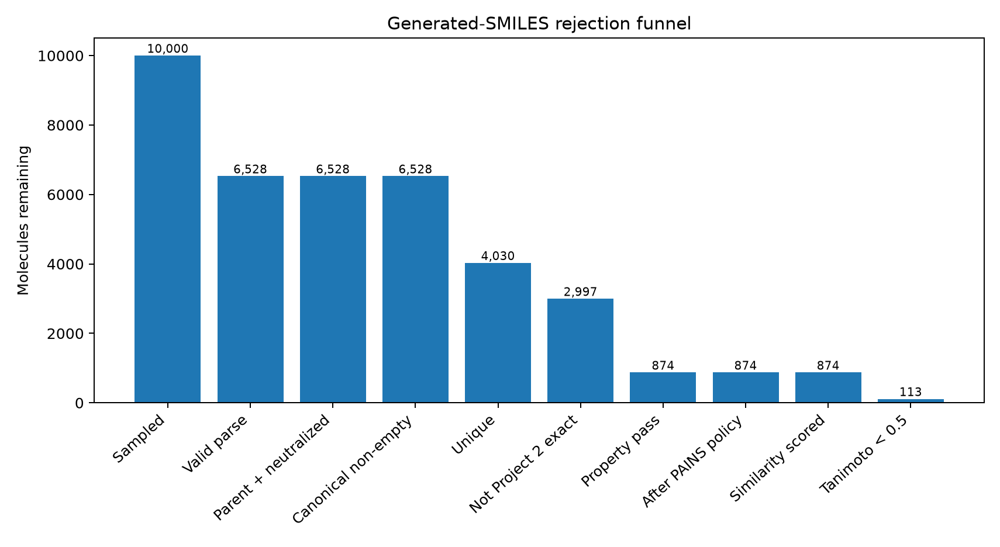
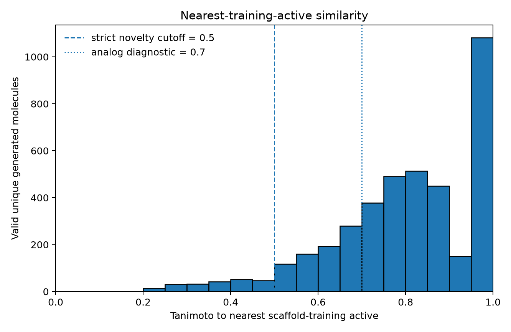
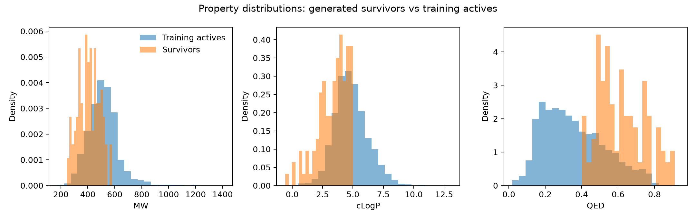
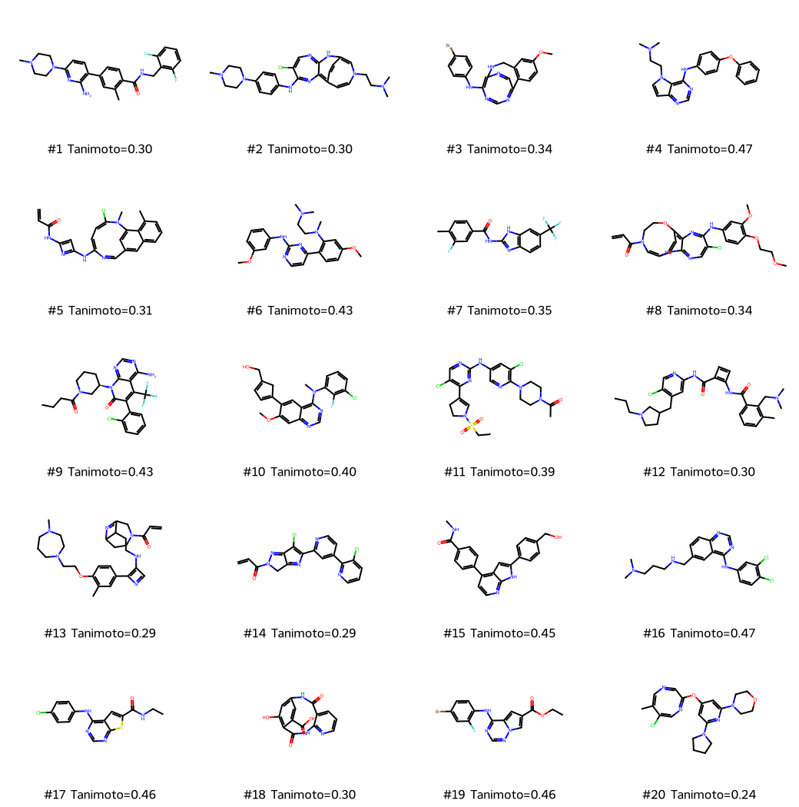

# EGFR Constrained Molecular Generation

[](https://github.com/drjoykarmakar/egfr-constrained-molgen/actions/workflows/ci.yml)

A small EGFR SMILES generator where the rejection funnel, not the generator, is the main result.

## Reviewer snapshot

- **Target:** human EGFR actives from the Project 2 cleaned ChEMBL 37 set (`CHEMBL203`)
- **Model:** small character-level SMILES LSTM trained on 6,279 scaffold-training actives
- **Sampled:** **10,000** SMILES in the frozen full run
- **Valid:** **6,528 / 10,000 (65.28%)**
- **Survived property filters + nearest-training-active Tanimoto < 0.5:** **113 / 10,000 (1.13%)**
- **Analog rate among valid unique samples:** **94.57%** at Tanimoto >=0.5; **76.15%** at >=0.7
- **Finding:** exact novelty was common, but fingerprint novelty was not; only 113 samples survived the predefined chemistry + novelty funnel, and Project 2 screening already produced comparably low-similarity candidates
- **Not claimed:** a new EGFR inhibitor or prospective experimental validation

## Scientific question

**If I sample molecules from a model trained on cleaned EGFR actives, how many survive validity, uniqueness, property filters, and a Tanimoto < 0.5 novelty cut against training actives?**

The answer in the frozen 10,000-sample run is **113 molecules (1.13%)**. The other 98.87% did not reach the final survivor set. The funnel was fixed before the full run; the 0.5 novelty threshold was not relaxed after seeing the output.

Project 1 scores properties: [admet-gnn-benchmark](https://github.com/drjoykarmakar/admet-gnn-benchmark). Project 2 ranks existing compounds and shows analog retrieval: [egfr-virtual-screen](https://github.com/drjoykarmakar/egfr-virtual-screen). Project 3 generates new SMILES from EGFR actives and asks how many are left after the same skepticism.

## Data provenance from Project 2

Project 3 uses **Project 2 (`egfr-virtual-screen`) v1.0.0 as the source of truth**. It does not issue a new EGFR ChEMBL query with different cleaning rules.

- target: human EGFR / ErbB1 (`CHEMBL203`)
- ChEMBL release: `ChEMBL_37`; release date `2026-05-01`
- active cutoff: `pActivity >= 6.0` (`<=1,000 nM` for the Project 2 nM activity definition)
- Project 2 classification benchmark: **9,476** standardized compounds
- generator training set: **6,279** active compounds from the Project 2 scaffold-training partition
- held-out comparison set: **802** Project 2 scaffold-test actives; never used to train the generator
- generator training-file SHA-256: `c444568de0d35881a4651892dd521077a0f256a2e69152cda1158fcacd4686c8`
- frozen raw-sample CSV SHA-256: `6486be1b712be2267cabad22d7b0b70f2f7503d8a635ee367264b4a3a9e65980`

`scripts/prepare_data.py` consumes the Project 2 processed classification table, scaffold assignments, and ChEMBL manifest. `data/processed/generation_training_manifest.json` records source paths, release metadata, counts, and checksums. The chemical standardization path matches Project 2: RDKit parse/sanitization -> MolStandardize cleanup -> parent fragment -> neutralization -> canonical isomeric SMILES.

## Generator

The generator is intentionally small: a **character-level SMILES LSTM** trained by next-character prediction on canonical SMILES from the scaffold-training actives. It uses a 128-dimensional embedding, two 256-unit LSTM layers, dropout 0.2, batch size 128, Adam-style learning rate `1e-3`, gradient clipping, and validation-token-loss monitoring. The vocabulary contains 39 symbols including explicit `<bos>`, `<eos>`, `<pad>`, and `<unk>` tokens.

The frozen run used seed **2026**, temperature **1.0**, top-k **40**, top-p **0.95**, maximum length **160**, and requested **10,000** samples. Training ran 50 epochs; the best validation token loss was **0.3415 at epoch 47**. The generator was not optimized against docking, the Project 2 activity model, or the novelty filter.

## Funnel

The filter order and thresholds were fixed before the full run.

| Funnel stage | Remaining | Survival vs sampled |
|---|---:|---:|
| Raw sampled SMILES | 10,000 | 100.00% |
| 1. RDKit parse + sanitization | 6,528 | 65.28% |
| 2. Parent fragment / salt strip / neutralization | 6,528 | 65.28% |
| 3. Non-empty checked canonical SMILES | 6,528 | 65.28% |
| 4. Unique standardized sample SMILES | 4,030 | 40.30% |
| 5. Not an exact match to any Project 2 EGFR benchmark molecule | 2,997 | 29.97% |
| 6. MW 200-600, cLogP -1 to 5, QED >=0.4 | 874 | 8.74% |
| 7. After PAINS policy (flag only; no deletion) | 874 | 8.74% |
| 8. Nearest scaffold-training-active similarity computed | 874 | 8.74% |
| 9. Tanimoto strictly <0.5 | **113** | **1.13%** |
| 10. Optional Project 2 RF score attached | 0 | disabled; does not affect membership |

Generation-quality diagnostics:

- validity: **65.28%**
- uniqueness among valid samples: **61.73%**
- exact novelty vs generator-training SMILES among valid unique samples: **75.56%**
- PAINS rate among valid unique samples: **5.91%** (238/4,030)
- PAINS flags among the 874 property-passing candidates: **59**; PAINS was recorded, not silently deleted
- mean pairwise Morgan Tanimoto among the 113 survivors: **0.129**



## Novelty histogram

Novelty is measured against the **same 6,279 scaffold-training actives used to train the generator**, using Morgan radius-2, 2,048-bit fingerprints with chirality and Tanimoto similarity. Held-out scaffold-test actives are not part of this reference.

Among the **4,030 valid unique samples**:

- **3,811 / 4,030 (94.57%)** had nearest-training-active Tanimoto >=0.5
- **3,069 / 4,030 (76.15%)** had Tanimoto >=0.7
- median nearest-training-active Tanimoto was **0.817**

Among the **874 property-passing, non-benchmark candidates**, **761** were rejected at Tanimoto >=0.5 and **530** were >=0.7. Only **113** survived the strict `<0.5` cut.

The distinction between exact and fingerprint novelty is important: **75.56%** of valid unique samples were not exact training-SMILES copies, yet most were still close fingerprint neighbors of training actives.



## Example survivors

The table shows 10 examples from the frozen 113-molecule survivor CSV. They are examples of structures that passed the predefined computational funnel, not experimentally supported inhibitors. The optional Project 2 activity scorer was disabled for this run.

| Sample | Standardized SMILES | MW | cLogP | QED | PAINS | Nearest-training-active Tanimoto |
|---:|---|---:|---:|---:|---|---:|
| 212 | `Cc1cc(-c2ccc(N3CCN(C)CC3)nc2N)ccc1C(=O)NCc1c(F)cccc1F` | 451.52 | 3.60 | 0.620 | No | 0.304 |
| 219 | `CN(C)CCN1C=CC2=C3N=C(Nc4ccc(N5CCN(C)CC5)cc4)C(Cl)=CN=C3NC(=C1)C=C2` | 505.07 | 3.39 | 0.641 | Yes | 0.303 |
| 230 | `COc1ccc2c(c1)CNC1=C(Nc3ccc(Br)cc3)N=CN=C2C=N1` | 410.28 | 3.70 | 0.811 | No | 0.338 |
| 408 | `CN(C)CCn1ccc2ncnc(Nc3ccc(Oc4ccccc4)cc3)c21` | 373.46 | 4.53 | 0.516 | No | 0.475 |
| 471 | `C=CC(=O)NC1=CC(NC2=CC=C(Cl)N(C)c3cc(cc4cccc(C)c34)C=N2)=N1` | 417.90 | 4.08 | 0.584 | No | 0.308 |
| 759 | `COc1cccc(Nc2nccc(-c3ccc(OC)cc3N(C)CCN(C)C)n2)c1` | 407.52 | 3.90 | 0.577 | No | 0.433 |
| 786 | `Cc1ccc(C(=O)Nc2nc3ccc(C(F)(F)F)cc3[nH]2)cc1F` | 337.28 | 4.28 | 0.686 | No | 0.351 |
| 847 | `C=CC(=O)N1C=C2C=CC(=C3N=C(Nc4ccc(OCCOC)c(OC)c4)C(Cl)=CN=C3N2)OCC1` | 511.97 | 3.28 | 0.427 | No | 0.336 |
| 853 | `CCCC(=O)N1CCC[C@@H](n2c(=O)c(-c3ccccc3Cl)c(C(F)(F)F)c3c(N)ncnc32)C1` | 493.92 | 4.68 | 0.569 | No | 0.433 |
| 950 | `COc1cc2ncnc(N(C)c3cccc(Cl)c3F)c2cc1C1=CC=C(CO)C1` | 411.86 | 4.90 | 0.646 | No | 0.400 |

The complete machine-readable set is in `results/lists/survivors.csv`.





## Comparison with Project 2 screen

The 113 generated survivors were compared with three fixed controls: Project 2's published low-similarity top 20, its property-filtered top 50, and a seeded 1,000-molecule sample from the same external library. The comparison did not change survivor membership.

| Group | n | Median MW | Median cLogP | Median QED | Median nearest-training-active Tanimoto | Fraction <0.5 | Mean pairwise Tanimoto |
|---|---:|---:|---:|---:|---:|---:|---:|
| Generated survivors | 113 | 410.28 | 3.60 | 0.610 | 0.367 | 1.000 | 0.129 |
| Project 2 interesting top 20 | 20 | 411.94 | 4.69 | 0.562 | 0.343 | 1.000 | 0.198 |
| Project 2 filtered top 50 | 50 | 388.42 | 4.40 | 0.490 | 0.579 | 0.420 | 0.172 |
| Project 2 random library control | 1,000 | 376.36 | 3.28 | 0.540 | 0.249 | 0.994 | 0.106 |

There was **zero exact-SMILES overlap** between the 113 generated survivors and each comparison set. Median nearest cross-set Tanimoto was **0.186** to Project 2's interesting top 20, **0.212** to its filtered top 50, and **0.250** to the random-library control; no generated survivor reached cross-set Tanimoto >=0.5 in these comparisons.

This supports a narrow conclusion: the generator produced a chemically different lower-similarity set under this fingerprint representation. It does **not** show that generation outperformed conventional screening. Project 2's interesting top 20 had a slightly lower median nearest-training-active Tanimoto (**0.343**) than the generated survivors (**0.367**), while the random-library control was lower still (**0.249**). Generation therefore added a distinct candidate set, not evidence of superior novelty or activity.

## What failed

The rejection rates are part of the result rather than hidden preprocessing.

- **3,472 / 10,000** raw samples failed RDKit parsing/sanitization.
- No additional molecules were lost at parent-fragment/neutralization or canonical non-empty checks after successful parsing.
- **2,498** additional valid samples were removed by exact-SMILES deduplication within the generated set.
- **1,033** unique generated structures were exact matches to molecules in the full Project 2 EGFR benchmark.
- **2,123** additional non-benchmark unique structures failed at least one MW/cLogP/QED property gate.
- **238 / 4,030** valid unique structures carried a PAINS flag; **59** PAINS flags occurred among the property-passing set. The configured policy was flag-only.
- **761 / 874** property-passing candidates were rejected by the fixed Tanimoto >=0.5 novelty rule; **530 / 874** were >=0.7.
- The LSTM produced substantial invalid and repetitive output despite a low validation token loss; syntactic next-token performance therefore did not translate into high usable-sample yield.
- Training ran the configured maximum of 50 epochs; the best validation token loss occurred at epoch 47. No post-hoc generator setting or novelty-threshold tuning was used to rescue the survivor count.
- The optional Project 2 Random Forest rescoring step was disabled, so no activity-model ranking is presented for the generated survivors.

Overall, **98.87% of raw samples did not reach the final novelty-aware survivor set**.

## Limitations

- The generator learns SMILES syntax and chemical-series patterns from known EGFR actives; it does not learn physical binding from first principles.
- Canonical-SMILES training can encourage repeated string and series motifs. String novelty is not equivalent to useful chemical novelty.
- Morgan/Tanimoto novelty depends on fingerprint representation and cutoff. The fixed `<0.5` threshold is a triage convention, not a universal chemotype definition.
- Property windows and PAINS alerts are inexpensive heuristics, not substitutes for medicinal-chemistry review.
- The Project 2 scaffold-test actives are retrospective known compounds, not prospective experimental evidence.
- Cross-set comparisons describe fingerprint similarity under the chosen representation; they do not establish biological novelty or superiority.
- No selectivity, ADME, toxicity, permeability, metabolism, synthetic feasibility, docking, crystal-structure analysis, or assay evidence is produced here.
- The 113 survivors are not ranked by experimental plausibility, and the optional Project 2 activity model was deliberately not used in this frozen run.

Generated molecules are computationally filtered hypotheses. They have not been synthesized or assayed in this repository.

## How to run

Reference environment: Python 3.11.

```bash
python3.11 -m venv .venv
source .venv/bin/activate
python -m pip install --upgrade pip
python -m pip install -r requirements.txt
python -m pytest -q
```

Place Project 2 beside this repository, then freeze the Project 3 source without a new ChEMBL query:

```bash
python scripts/prepare_data.py --config configs/default.yaml \
  --project2-root ../egfr-virtual-screen
```

A small smoke path is available and is not part of the reported experiment:

```bash
python scripts/train_generator.py --config configs/default.yaml --demo
python scripts/run_filters.py --config configs/default.yaml --demo
python scripts/make_report.py --config configs/default.yaml --demo
```

Reproduce the full run with:

```bash
python scripts/train_generator.py --config configs/default.yaml
python scripts/sample_smiles.py --config configs/default.yaml
python scripts/run_filters.py --config configs/default.yaml
python scripts/compare_project2.py --config configs/default.yaml
python scripts/make_report.py --config configs/default.yaml
```

The full raw sample list is retained as a reproducibility artifact for the documented run; summary tables and the smaller survivor list are the intended review surfaces. CI runs unit tests rather than retraining and sampling 10,000 strings.

## What this repo does not claim

This repository does **not** claim an experimentally confirmed EGFR inhibitor, an experimentally tested molecule, a foundation model, a production-scale generative platform, a multi-target system, or a docking study. It does not present generator output or a model score as experimental potency. The purpose is to show how aggressively a small molecular generator must be rejected and audited before its output is worth further computational review.
